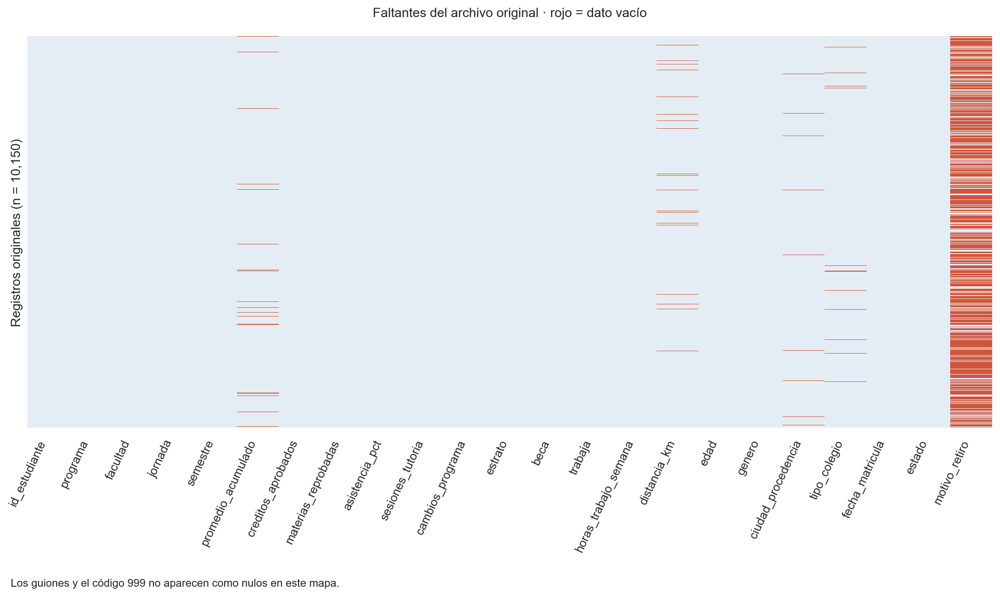
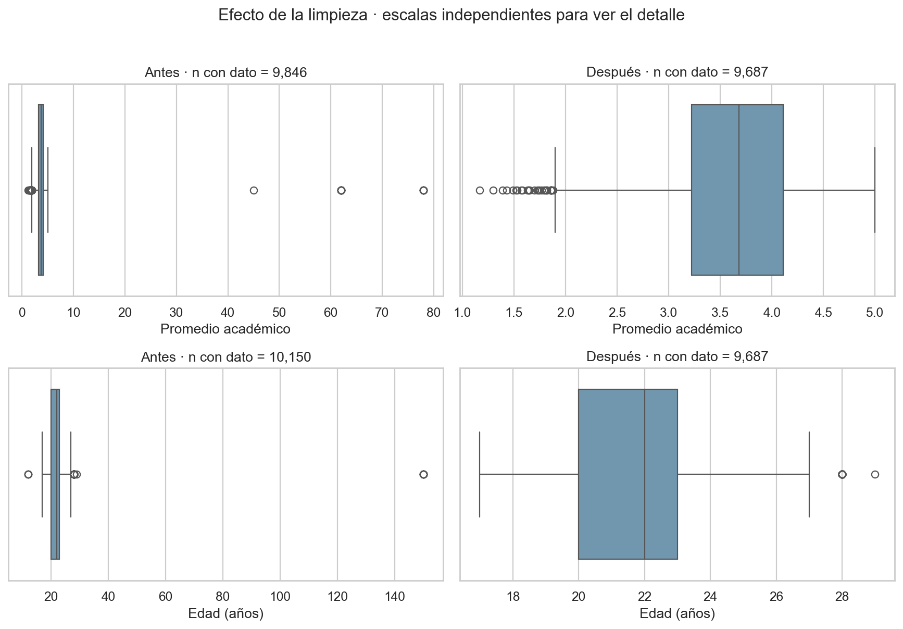
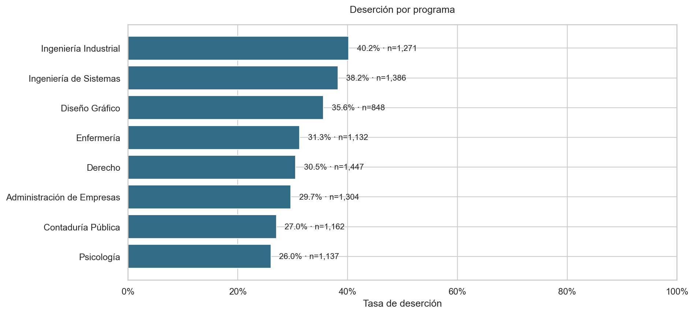
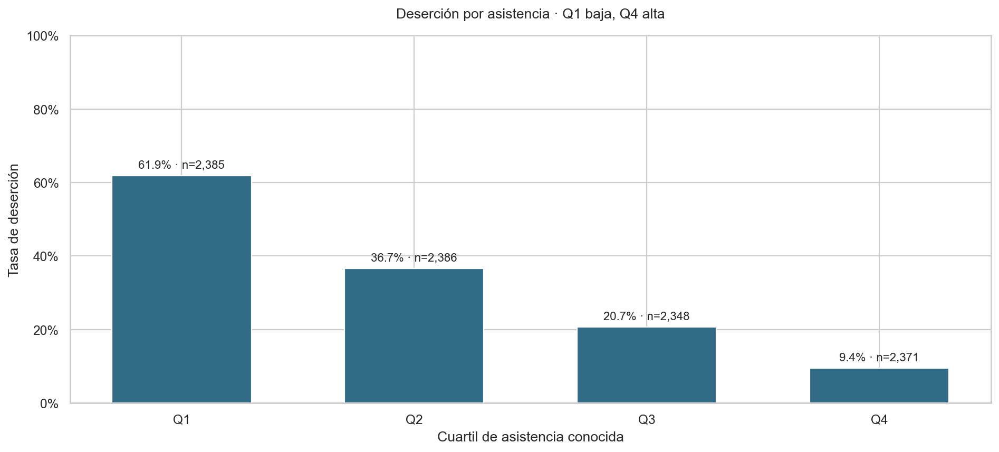

# Calidad de datos para la retención estudiantil

Proyecto académico de auditoría, limpieza y análisis de datos de estudiantes con Pandas. Incluye decisiones justificadas, cuatro gráficos y las respuestas a cinco preguntas sobre deserción.

Los datos son sintéticos. La plantilla, el dataset y el enunciado provienen del [repositorio del docente Diego Giraldo](https://github.com/DiegoGiraldoCesde/limpieza_df_Pandas). Esta entrega contiene el desarrollo del análisis y su documentación.

## Resultados principales

- Entrada: 10150 registros y 23 columnas.
- Resultado: 9687 estudiantes y 25 columnas, tras eliminar duplicados y registros sin nota válida.
- 26 decisiones documentadas y cuatro gráficos.
- Mayor tasa de deserción: Ingeniería Industrial, 40.20%.
- El análisis describe asociaciones; no demuestra relaciones causales.

## Ejecutar el proyecto

Requiere Python 3.11 o superior. Descarga o clona este repositorio y abre una terminal dentro de la carpeta que contiene `analisis_desercion.py`.

En Windows (PowerShell):

```powershell
python -m venv .venv
.\.venv\Scripts\python.exe -m pip install -r requirements.txt
.\.venv\Scripts\python.exe analisis_desercion.py --sin-ventanas
```

En macOS o Linux:

```bash
python3 -m venv .venv
.venv/bin/python -m pip install -r requirements.txt
.venv/bin/python analisis_desercion.py --sin-ventanas
```

Si el entorno ya existe, omite su creación. La opción `--sin-ventanas` guarda las imágenes sin abrir ventanas. Si la omites, cierra cada gráfico para continuar la ejecución. No es necesario activar el entorno al usar la ruta completa a su Python.

Al terminar debe aparecer: `Dataset limpio guardado: 9687 filas, 25 columnas.`

## Archivos de la entrega

```text
entrega_retencion_estudiantil/
├── README.md
├── analisis_desercion.py
├── requirements.txt
├── LEEME_ambiente.txt
├── .gitignore
├── Taller_Retencion_Estudiantil.pdf
└── Data/
    ├── raw/
    │   └── datos_estudiantes.csv
    └── processed/
        ├── decisiones.csv
        └── graficos/
            ├── mapa_faltantes.png
            ├── distribuciones_antes_despues.png
            ├── tasa_desercion_por_programa.png
            └── tasa_desercion_por_asistencia.png
```

El programa genera tambi?n `Data/processed/dataset_limpio.csv`, excluido de Git. Los datos originales se conservan intactos. Los entornos virtuales y archivos temporales no forman parte de la entrega.

El informe completo, las tablas de resultados y las reflexiones están a continuación.

## Mis decisiones y respuestas

Los siguientes resultados se calcularon con el archivo suministrado. Son datos sintéticos y resultados descriptivos; no son una evaluación causal de una institución real. Se usa punto decimal en las tablas. Los conteos de auditoría corresponden al archivo original, mientras que las respuestas corresponden a la población después de limpiar.

### 0. Diccionario de datos

El tipo describe el significado esperado de la columna, no necesariamente el tipo con que Pandas la leyó inicialmente.

| Columna | Tipo | Descripción | Rol |
|---|---|---|---|
| id_estudiante | Texto | Identificador de cada estudiante; no se promedia | Identificación |
| programa | Categórica | Programa académico en el que estudia | Explicativa |
| facultad | Categórica | Facultad a la que pertenece el programa | Explicativa |
| jornada | Categórica | Jornada diurna, nocturna o de fin de semana | Explicativa |
| semestre | Numérica discreta, ordinal | Semestre académico que cursa | Explicativa |
| promedio_acumulado | Numérica continua | Promedio académico en escala de 0 a 5 | Explicativa |
| creditos_aprobados | Numérica discreta | Cantidad de créditos aprobados | Explicativa |
| materias_reprobadas | Numérica discreta | Cantidad de materias reprobadas | Explicativa |
| asistencia_pct | Numérica continua | Porcentaje de asistencia, de 0 a 100 | Explicativa |
| sesiones_tutoria | Numérica discreta | Número de sesiones de tutoría registradas | Explicativa |
| cambios_programa | Numérica discreta | Número de cambios de programa registrados | Explicativa |
| estrato | Categórica ordinal | Estrato socioeconómico registrado, de 1 a 6 | Explicativa sensible |
| beca | Categórica binaria | Indica si recibe beca: sí o no | Explicativa |
| trabaja | Categórica binaria | Indica si trabaja: sí o no | Explicativa |
| horas_trabajo_semana | Numérica | Horas de trabajo semanales | Explicativa |
| distancia_km | Numérica continua | Distancia registrada de desplazamiento en kilómetros | Explicativa |
| edad | Numérica discreta | Edad en años | Explicativa |
| genero | Categórica | Género registrado en el archivo | Explicativa sensible |
| ciudad_procedencia | Categórica | Ciudad de procedencia | Explicativa sensible |
| tipo_colegio | Categórica | Tipo de colegio de procedencia: público o privado | Explicativa |
| fecha_matricula | Fecha | Fecha de matrícula registrada | Explicativa |
| estado | Categórica | Situación del estudiante: activo, desertor o graduado | Resultado |
| motivo_retiro | Categórica | Motivo declarado después del retiro | Resultado posterior; no predictor temprano |

Las columnas nuevas son `desertor` (indicador booleano del resultado) y `cuartil_asistencia` (categoría ordinal Q1 a Q4). Una variable explicativa solo podría usarse para predecir si su valor ya estaba disponible en la fecha de la predicción.

### 1. Diagnóstico de calidad

El original tiene **10150 filas y 23 columnas**. Hay 150 filas duplicadas completas y 10000 identificaciones diferentes. Los duplicados coinciden también en la identificación, por lo que no representan estudiantes distintos.

| Problema observado en el original | Cantidad |
|---|---:|
| Nulos en promedio_acumulado | 304 |
| Nulos en distancia_km | 199 |
| Nulos en ciudad_procedencia | 103 |
| Nulos en tipo_colegio | 152 |
| Nulos en motivo_retiro | 6877 |
| Guiones en asistencia_pct | 202 |
| Guiones en horas_trabajo_semana | 2822 |
| Distancias codificadas con 999 | 152 |
| Asistencias con símbolo % | 300 |
| Edades fuera de 15 a 60 | 12 |
| Promedios fuera de 0 a 5 | 17 |
| Horas de trabajo mayores de 100 | 30 |
| Fechas en DD/MM/AAAA | 3052 |
| Fechas en AAAA-MM-DD | 7098 |
| Escrituras por corregir en programa | 260 |
| Escrituras por corregir en jornada | 485 |
| Escrituras por corregir en genero | 559 |
| Escrituras por corregir en ciudad_procedencia | 542 |

`asistencia_pct` y `horas_trabajo_semana` se leen como texto debido a los símbolos y guiones. `distancia_km` ya es numérica, pero contiene el código 999. `fecha_matricula` se lee como texto y requiere interpretación explícita.

Las edades señaladas son 12 (4 registros) y 150 (8). El rango 15 a 60 es una regla del taller: estar fuera de él no demuestra por sí solo una imposibilidad biológica. Los promedios señalados son 45 (1), 62 (10) y 78 (6). Las 30 horas extremas son valores de 200 horas semanales.

Los 6877 motivos vacíos corresponden a 5977 activos y 900 graduados; ninguno de los 3273 registros de desertores tiene ese dato vacío. Es un faltante esperado. El mapa de faltantes lo muestra como la columna con más huecos. Los demás huecos visibles coinciden con los conteos de nulos, pero los guiones y el 999 no se detectan mediante `isna()`.

Los promedios fuera de escala afectan directamente la comparación de jornadas; las variantes de programa fragmentan las tasas; y eliminar indiscriminadamente todos los nulos excluiría a los no desertores. El impacto depende de la pregunta: no basta con ordenar los problemas por cantidad.

### 2. Decisiones de limpieza y sus límites

1. Convertir asistencia y horas a números. Quitar `%` sin dividir por 100, porque la asistencia queda en escala de 0 a 100. Cambiar guiones y distancias 999 a nulos. Contarlos antes de convertir permite conservar su origen en la bitácora.
2. Normalizar espacios y mayúsculas, y corregir solo variantes observadas: tildes de programas y ciudades, y abreviaturas F/M del género según las categorías del taller. No fusionar programas o ciudades diferentes. El código detiene el proceso si encuentra una categoría nueva no contemplada.
3. Interpretar las fechas con los dos formatos explícitos. Se convierten todas y no queda ninguna fecha inválida.
4. Eliminar 150 duplicados completos. Quedan 10000 estudiantes; no hay identificaciones repetidas con información diferente.
5. Eliminar 298 estudiantes sin promedio después de quitar duplicados. No se inventa una nota ni se sustituye por el promedio del grupo. Se adopta una población común para las cinco preguntas, aunque una alternativa sería conservar esas filas para preguntas que no usan la nota.
6. Rellenar ciudad con `Sin dato` en 96 filas y tipo de colegio en 145. Así se conserva información de esas personas sin atribuirles una categoría real desconocida.
7. Eliminar 15 estudiantes con promedio fuera de 0 a 5. No se divide arbitrariamente entre 10 o 20, pues no hay evidencia suficiente para reconstruir la escala original.
8. Marcar como faltantes las 12 edades fuera del rango del ejercicio y reemplazarlas por la mediana de edades válidas, **22 años**. Esta imputación conserva los registros, pero reduce la variabilidad de la edad.
9. Asignar cero horas a 2703 estudiantes que declaran no trabajar y tenían un faltante. En quienes trabajan, marcar como nulos los 29 valores extremos restantes e imputar **24 horas**, la mediana calculada solo entre trabajadores con horas válidas.
10. Conservar los faltantes de asistencia y distancia. Imputar asistencia podría mover estudiantes a cuartiles artificiales. Conservar los motivos de retiro vacíos de quienes no desertaron.
11. Crear `desertor` y cuatro cuartiles de asistencia. Q1 contiene las asistencias más bajas y Q4 las más altas. Los empates hacen que sus tamaños no sean exactamente iguales; los intervalos no son cuatro franjas fijas de 25 puntos porcentuales.

El resultado tiene **9687 filas y 25 columnas**:

```text
10150 originales - 150 duplicados - 298 sin nota - 15 notas fuera de escala = 9687
```

Quedan 197 asistencias y 333 distancias desconocidas; además, 6551 motivos de retiro no aplicables. Los 197 cuartiles vacíos corresponden exactamente a las asistencias desconocidas. Un dataset limpio puede conservar faltantes justificados.

La bitácora [decisiones.csv](Data/processed/decisiones.csv) contiene 26 entradas. Los conteos se hacen en el momento de cada operación: una fila puede aparecer en varias decisiones, y algunas se eliminan después. Por eso **no se deben sumar todas las filas afectadas como si fueran estudiantes distintos**. “Conservar nulos” describe registros revisados, no celdas modificadas.

La exclusión por nota afecta a 313 de 10000 estudiantes únicos (3.13%): 186 activos, 100 desertores y 27 graduados. La tasa global pasa de 32.36% antes de esa exclusión a 32.37% después; en los excluidos era 31.95%. La similitud global no demuestra ausencia de sesgo dentro de cada programa o grupo.

### 3. Respuestas a las cinco preguntas

La tasa es `desertores / estudiantes del grupo`. El denominador incluye activos, desertores y graduados, salvo en la pregunta 4. El análisis final contiene 5692 activos, 3136 desertores y 859 graduados. Las tasas son proporciones descriptivas del archivo, no tasas anuales de seguimiento ni riesgos futuros estimados.

#### Pregunta 1: ¿qué programa presenta la tasa más alta?

| Programa | Estudiantes | Desertores | Tasa |
|---|---:|---:|---:|
| Ingeniería Industrial | 1271 | 511 | 40.20% |
| Ingeniería de Sistemas | 1386 | 530 | 38.24% |
| Diseño Gráfico | 848 | 302 | 35.61% |
| Enfermería | 1132 | 354 | 31.27% |
| Derecho | 1447 | 442 | 30.55% |
| Administración de Empresas | 1304 | 387 | 29.68% |
| Contaduría Pública | 1162 | 314 | 27.02% |
| Psicología | 1137 | 296 | 26.03% |

**Ingeniería Industrial** tiene la tasa más alta: 511 de 1271 estudiantes (40.20%). Ingeniería de Sistemas tiene más desertores en cantidad (530), pero una proporción menor. Diseño Gráfico es el grupo más pequeño, con 848 estudiantes; ninguno de estos programas tiene solo unas pocas observaciones. Esto no prueba que las diferencias sean estadísticamente significativas o causadas por el programa.

#### Pregunta 2: ¿hay diferencia entre becados y no becados?

| Beca | Estudiantes | Desertores | Tasa |
|---|---:|---:|---:|
| No | 7004 | 2548 | 36.38% |
| Sí | 2683 | 588 | 21.92% |

Los becados muestran una tasa **14.46 puntos porcentuales menor**. Se observa una asociación, pero no se ha aislado el efecto de la beca: el rendimiento previo, las condiciones de selección y otros recursos pueden diferir entre los grupos.

#### Pregunta 3: ¿qué jornada tiene el menor promedio acumulado?

| Jornada | Estudiantes | Promedio acumulado |
|---|---:|---:|
| Nocturna | 2666 | 3.4644 |
| Fin de semana | 949 | 3.7045 |
| Diurna | 6072 | 3.7249 |

La jornada **Nocturna** tiene el menor promedio, 3.4644, entre sus 2666 estudiantes. Son promedios calculados únicamente con notas conocidas y dentro de la escala 0 a 5.

#### Pregunta 4: ¿cuántas materias reprueban los desertores frente a los activos?

| Estado | Estudiantes | Materias reprobadas en promedio |
|---|---:|---:|
| Activo | 5692 | 0.6232 |
| Desertor | 3136 | 3.0660 |

Los desertores registran alrededor de **3.07 materias reprobadas**, frente a **0.62** entre los activos. Se excluyen 859 graduados porque no pertenecen a ninguno de los dos estados comparados. La comparación incluye 8828 personas y no establece por sí sola qué ocurrió primero ni una relación causal.

#### Pregunta 5: ¿la deserción aumenta cuando baja la asistencia?

| Cuartil | Estudiantes | Asistencia observada (%) | Asistencia promedio (%) | Desertores | Tasa |
|---|---:|---|---:|---:|---:|
| Q1 | 2385 | 48.0 a 80.5 | 73.90 | 1476 | 61.89% |
| Q2 | 2386 | 80.6 a 87.8 | 84.41 | 875 | 36.67% |
| Q3 | 2348 | 87.9 a 95.0 | 91.34 | 487 | 20.74% |
| Q4 | 2371 | 95.1 a 100.0 | 98.66 | 224 | 9.45% |

Sí, aparece un patrón ordenado: a menor asistencia, mayor proporción de desertores. La diferencia entre Q1 y Q4 es de 52.44 puntos porcentuales. Los intervalos de la tabla muestran los mínimos y máximos observados, no los límites matemáticos exactos calculados por `qcut`.

Se analizan 9490 estudiantes con asistencia conocida. Los otros 197 quedan fuera únicamente de esta comparación; entre ellos hay 74 desertores (37.56%). La falta de asistencia registrada también puede sesgar la comparación. La asociación no prueba que aumentar la asistencia por sí solo evite la deserción: trabajo, salud, dificultades económicas o un abandono ya iniciado pueden influir en ambas variables.

### 4. Lectura de los cuatro gráficos



Los huecos de `motivo_retiro` dominan el mapa porque no aplica a activos ni graduados. Los faltantes disfrazados solo se reconocen mediante la auditoría específica.



El promedio pasa de un máximo de 78 a 5, y su media de 3.7607 a 3.6512. La edad pasa de un rango de 12–150 a 17–29 años. La comparación refleja también las filas excluidas y los duplicados eliminados, no solo las imputaciones. Los paneles usan escalas independientes para mostrar el detalle.

Se conservan notas bajas como 1.17 y edades de 28 o 29 que el boxplot señala como atípicas: están dentro de los rangos aceptados. Un punto fuera de los bigotes no demuestra un error. Los bigotes corresponden a la regla estadística del boxplot, no a límites de validez del dato.



El orden de las barras corresponde a la pregunta 1. Cada etiqueta incluye el número de estudiantes para evitar confundir cantidad con proporción.



La reducción de Q1 a Q4 corresponde a la pregunta 5. Los cuatro grupos tienen entre 2348 y 2386 estudiantes. Ambas gráficas de tasas usan escala de 0 a 100%.

### 5. Reflexión: asociación y causalidad

La diferencia entre becados y no becados no demuestra que la beca cause permanencia. Por ejemplo, si una beca se otorga por buen desempeño previo, ese desempeño podría estar asociado tanto a recibirla como a continuar estudiando. También pueden influir ingresos, tiempo disponible, acompañamiento y programa.

Para investigar un efecto haría falta conocer cuándo se otorgó la beca, medir condiciones anteriores y comparar grupos suficientemente equivalentes, mediante un diseño experimental o una evaluación observacional que justifique sus supuestos. Este archivo permite describir diferencias, pero no identificar ese efecto causal.

### 6. Reflexión: variables que no deben usarse para predecir

`motivo_retiro` se conoce después de desertar. Usarlo para anticipar el abandono sería una fuga de información: incluso que esté vacío o lleno revela el resultado en este dataset. `estado` y `desertor` son el resultado que se intentaría predecir, no entradas de un modelo.

Promedio, créditos, materias reprobadas, asistencia y tutorías también podrían filtrar información futura si se calculan después de la fecha elegida para predecir. Sería necesario usar sus valores históricos disponibles en ese momento. La identificación no describe por sí misma un riesgo y no debe convertirse en una variable numérica explicativa.

### 7. Reflexión: variables sensibles

Género, estrato y ciudad pueden reflejar desigualdades de acceso y oportunidades. Una asociación no justifica negar un beneficio ni etiquetar a una persona como destinada a desertar. Estas variables pueden servir para auditar desigualdades y orientar apoyos, con una finalidad explícita y revisión humana.

Una decisión de apoyo debería considerar necesidades individuales, proteger la información y revisar errores y resultados por grupo. Excluir las variables sensibles del cálculo no garantiza equidad, porque programa, jornada o distancia pueden actuar como aproximaciones. En este taller no se entrenó un modelo ni se tomaron decisiones sobre personas reales.

### 8. Ejecución y comprobaciones

El programa carga siempre el original, ejecuta los pasos en orden, valida 17 reglas de calidad y guarda los resultados. Verifica identificaciones únicas, rangos, categorías, fechas, coherencia entre trabajo y horas, y correspondencia entre asistencia faltante y cuartil vacío. Los gráficos se guardan antes de mostrarse.

Se comprobó la ejecución en una carpeta de salida vacía: los dos CSV y los cuatro PNG se regeneraron con contenido idéntico. También se contrastaron las tasas con una tabla de frecuencias independiente, las identificaciones conservadas con el original y la integridad del archivo fuente mediante SHA-256. Las dependencias instaladas no presentan conflictos.

`Data/raw` se conserva intacto. Los resultados se pueden regenerar con el comando indicado al inicio. El dataset limpio se genera localmente y está excluido de Git; `decisiones.csv` y los cuatro PNG sí forman parte de la entrega. Las conclusiones de este README corresponden a la versión suministrada del CSV: si cambia el original, deben recalcularse y revisarse.
